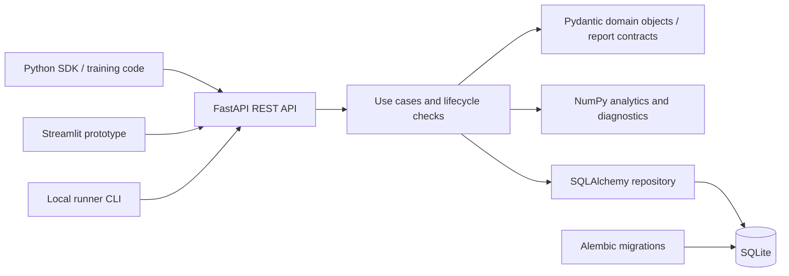

# Data Decision Workspace (DDW)

A decision workspace for ML data decisions: connect observed errors and training evidence to hypotheses, proposed data actions, and recorded decisions. DDW makes uncertainty explicit so that the next data experiment has a reason and a traceable history.

**Status: backend MVP.** The repository name is `data-decision-layer`; the project is Data Decision Workspace. It is intended for local evaluation with synthetic or approved data. No production deployment or performance claims are made.

## Implemented scope

- Pydantic domain objects for errors, hypotheses, actions, decisions, and data potential, with lifecycle checks in use cases.
- FastAPI REST endpoints with tenant-scoped persistence, pagination, run ingestion (RunReport v1/v2), jobs and runner registration.
- SQLAlchemy persistence and seven Alembic migration revisions; SQLite is the documented local path.
- NumPy learning-curve analysis and run diagnostics, including persisted diagnosis history and explicit insufficient-evidence outcomes.
- Streamlit prototype UI and local runner/analysis command-line modules.

Further product work is exploratory. The [learning success criteria](docs/03_Learning_MVP_Success_Criteria.md) describe goals, not measured outcomes. Automated model improvement, automatic causal conclusions, general-purpose MLOps orchestration, and production hosting are outside the demonstrated scope.

## Architecture



`core/` defines domain objects; `contracts/` defines run reports; `use_cases/` coordinates decisions and evidence; `store/` persists them; `api/` exposes transport schemas and routes. `tests/` covers domain rules, tenant isolation, API contracts, migrations, ingestion, and analysis.

## Local quickstart

Requires Python 3.11 or newer. Run commands from the repository root. The backend runs from a source checkout; `requirements.txt` is its dependency installation path.

```bash
git clone https://github.com/AchillesJS/data-decision-layer.git
cd data-decision-layer
python3 -m venv .venv
source .venv/bin/activate
python -m pip install -r requirements.txt
mkdir -p data
export DDW_DB_URL=sqlite+pysqlite:///./data/ddw.db
python -m alembic upgrade head
python -m uvicorn api.main:app --host 127.0.0.1 --port 8000
```

On Windows, activate with `.venv\Scripts\Activate.ps1`, create `data` if absent, and set `$env:DDW_DB_URL = "sqlite+pysqlite:///./data/ddw.db"`. See [Windows setup](docs/dev_setup_windows.md).

Open [interactive API docs](http://127.0.0.1:8000/docs). `DDW_CORS_ORIGINS` configures comma-separated browser origins. Set it explicitly if needed; CORS does not provide authentication.

### Synthetic API example

With the API running:

```bash
curl http://127.0.0.1:8000/health
curl -X POST http://127.0.0.1:8000/api/v1/runs/ingest \
  -H 'Content-Type: application/json' -H 'X-Tenant-Id: portfolio-demo' \
  -d '{"schema_version":2,"external_run_id":"synthetic-demo-1","run":{"model_tag":"synthetic-baseline","dataset_size":100,"budget_kind":"epochs","budget_value":1,"metric_name":"accuracy","metric_final":0.75,"split":"val","status":"SUCCEEDED"},"metric_points":[{"series_name":"val","x_kind":"epoch","x_value":1,"y_value":0.75}],"diagnostic_signals":[]}'
curl -H 'X-Tenant-Id: portfolio-demo' http://127.0.0.1:8000/api/v1/runs
```

The number above is synthetic input, not a benchmark. Run ingestion returns a run ID and creation indicator. Domain endpoints require `X-Tenant-Id`; runner operations additionally use runner and lease tokens where defined.

### Optional UI

```bash
python -m pip install streamlit requests
python -m streamlit run ui/app.py
```

Configure the backend URL and tenant in the UI. See [UI guide](docs/ddw_ui_docs.md). UI dependencies are optional and absent from the backend requirements.

## Python SDK relationship

The separate [DDW Python SDK](https://github.com/AchillesJS/ddw-sdk-py) collects explicitly logged training metrics and diagnostics and submits RunReport v2 to this backend. It does not implement the decision workspace or the backend analytics. Compatibility is based on the report contract, not matching package version numbers. The SDK README identifies the audited backend revision.

## Development checks

```bash
python -m pytest -q
python -m ruff check .
python -m mypy core store api
```

See [contribution guidance](CONTRIBUTING.md). Tests use temporary databases; the API requires migrations for a persistent local database. No sample CSV is distributed.

## Limitations and trust boundary

- Tenant IDs scope records but are caller-supplied, not authenticated identities. Do not expose this MVP API to untrusted users.
- The local runner executes submitted shell commands with host privileges. Use only in an isolated, trusted local environment; public hosting with a connected runner is blocked pending authorization and execution isolation work.
- Learning analysis depends on comparable runs and adequate evidence. Diagnostic findings are suggestions, not causal proof or guaranteed improvements.
- No validated production scaling, hosted service, or general database portability guarantee is provided. Dependencies use ranges rather than a locked environment.
- The backend packaging metadata is incomplete for distribution; use the source setup above.

## Detailed documentation

- [Product canon](docs/canon.md) and [non-goals](docs/anti_features.md)
- [Lifecycle state machine](docs/state_machine.md)
- [API v1 domain reference](docs/api_v1.md) (interactive OpenAPI includes newer routes)
- [Migrations](docs/migrations.md) and [Alembic notes](docs/alembic.md)

Some detailed design notes remain in Russian and describe intent. Source contracts and executed tests establish current behavior.

## Licensing

No LICENSE file is present. Public visibility does not establish an open-source license. Licensing terms require an owner decision; this documentation does not grant new rights.
